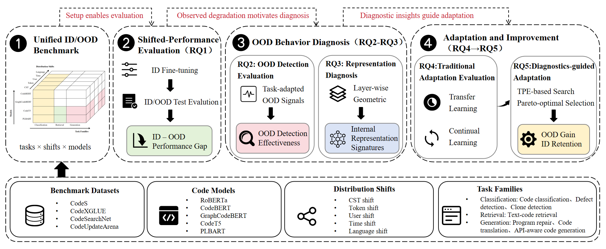
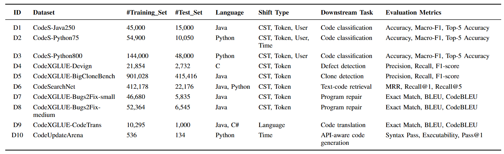

# Understanding and Mitigating Representation Drift of Code Models under Software Distribution Shifts

We investigate the performance degradation, OOD detection, representation characteristics, and adaptation strategies of pretrained code models across diverse software engineering tasks.

  Overview of Our Study

  

## 1. Experimental Setup

### Datasets and Distribution Shifts

The datasets, ID/OOD settings, downstream tasks, and evaluation metrics used in our study are summarized below.

  

### Pretrained Models

We evaluate five representative pretrained code models:

- RoBERTa
- CodeBERT
- GraphCodeBERT
- CodeT5
- PLBART

## 2. OOD Detection

We investigate task-adapted OOD detection methods based on the prediction structures of different downstream tasks.

| Task Family | Detection Methods |
|---|---|
| Classification | MSP, Entropy, MaxLogit, Energy, Mahalanobis, Mahalanobis++, KNN, ViM, GradNorm |
| Retrieval | Matching Score, Ranking Entropy, KNN Distance |
| Generation | Sequence-level NLL, Token Entropy, Encoder Distance |

Detection effectiveness is evaluated using AUROC, AUPR, and TNR@95.

## 3. Representation Diagnostics

We analyze ID–OOD representation differences using four complementary diagnostics:

- **Alignment**
- **Anisotropy**
- **Effective Rank**
- **Entropy**

Layer-wise representations are extracted from fine-tuned models to investigate how distribution shifts affect representation characteristics.

## 4. Model Adaptation

We evaluate three conventional adaptation strategies:

- Transfer Learning (TL)
- Elastic Weight Consolidation (EWC)
- Replay

We further propose a representation-diagnostics-guided adaptation framework based on Replay, incorporating TPE-based configuration search, OOD data re-splitting, Pareto selection, and configuration transfer.

## 5. Environment

Experiments are conducted in a Linux environment.

| Component | Version |
|---|---|
| Python | 3.8.5 |
| NumPy | 1.19.5 |
| Pandas | 1.3.4 |
| SciPy | 1.7.2 |
| scikit-learn | 1.0.1 |
| Matplotlib | 3.4.3 |
| TensorFlow | 2.5.0 |

Other dependencies are specified by the corresponding model implementations.
